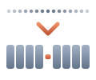

<div align="center">



# Human Short Code

**Turn long numeric ids into short codes people can read, say and type.**

`987654` becomes `QRQW-ISAA`, and decodes back to `987654`.

[](https://pypi.org/project/human-short-code/)
[](https://www.npmjs.com/package/human-short-code)
[](LICENSE)
[](https://github.com/Levia-Labs/Crepidoma)

</div>

## Why

1. **Readable.** Fixed-length `ABCD-EFGH` codes with a hyphen in the middle, easy to dictate over the phone.
2. **Reversible.** Encoding is a bijection on the id range; no lookup table or database needed.
3. **Configurable.** Bring your own alphabet and code length.
4. **Zero dependencies.** Same algorithm and output in Python and JavaScript.

Good fits: referral codes, room codes, order and ticket references, support ids.

## Quick start

Python:

```bash
pip install human-short-code
```

```python
from human_short_code import encode, decode, verify

code = encode(987654)   # "QRQW-ISAA"
decode(code)            # 987654
verify(code)            # True
```

JavaScript / TypeScript:

```bash
npm install human-short-code
```

```ts
import { hsc } from "human-short-code";

const code = hsc.encode(987654); // "QRQW-ISAA"
hsc.decode(code);                // 987654
hsc.verify(code);                // true
```

The default alphabet `ASDEIUNWRQXBOKH` with length 8 covers ids from 0 to 15^8 - 1 (2,562,890,624). Package docs: [python/](python/README.md), [javascript/](javascript/README.md).

## Development

Tasks run through [Task](https://taskfile.dev); `task --list` is the index.

```bash
git clone --recurse-submodules https://github.com/Levia-Labs/HumanShortCode.git
task py:test
task js:test
```

## Levia Labs

1. [Crepidoma](https://github.com/Levia-Labs/Crepidoma): the shared LLM tooling foundation this repo is built on.
2. [QC2C](https://github.com/Levia-Labs/QC2C): quick coordinates to country.
3. [beat-analyser](https://github.com/Levia-Labs/beat-analyser): music beat data extraction with madmom, dockerized.
4. [saber-tooth](https://github.com/Levia-Labs/saber-tooth): Beat Saber modding API for custom levels.

## License

[MIT](LICENSE)
